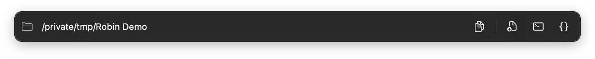
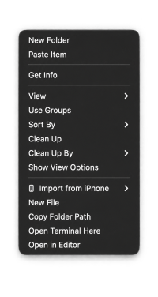

# Robin



**Finder’s little sidekick.** An editable path bar that follows Finder, plus New File, Copy Folder Path, and quick Terminal/editor actions.

Requires macOS 14+; supports Apple Silicon and Intel.

## Overview

Robin lives in the menu bar and adds a floating location bar just below the active Finder window.

- **Editable folder path:** copy the current location or type a different path. Press **Return** to open it or **Escape** to cancel. Absolute paths, relative paths, and `~/` are supported. Press **Tab** for folder autocomplete, then select a suggestion with the mouse or arrow keys and Return.
- **New File:** create an empty file in the current folder with a compact filename dialog.
- **Quick tools:** open Terminal in the current folder, or choose an editor to open it in.
- **Finder right-click actions:** New File, Copy Folder Path, Open Terminal Here, and Open in Editor are also available when you right-click a folder or Finder’s background.
- **Guided setup:** required Finder permissions, a quick tour, and optional launch at login. Reopen **Setup & Tour…** from the menu bar whenever you need it.

[](docs/screenshots/context-menu.png)

## Install

```sh
brew install --cask durklas0x/tap/robin
```

Or download the ZIP from [Releases](https://github.com/durklas0x/robin/releases/latest), unzip it, and move `Robin.app` to Applications.

## First launch

Robin is currently ad-hoc signed, **not notarized**. If macOS blocks it, try opening it once, then use **System Settings → Privacy & Security → Open Anyway** ([Apple’s instructions](https://support.apple.com/102445)).

If macOS reports it as damaged or the approval option is unavailable, and you trust this release, remove quarantine from **Robin only**:

```sh
xattr -dr com.apple.quarantine /Applications/Robin.app
```

On first launch, Robin guides you through enabling its Finder extension and allowing Finder Automation. Both are required before Robin starts. Closing setup quits Robin; your progress resumes next launch.

Choose **Setup & Tour…** from the menu bar to reopen the guide or change launch at login. Terminal requests Automation access when you first use it.

## Build / release

Install Xcode 26.2+ and XcodeGen, then:

```sh
xcodegen generate
xcodebuild -project Robin.xcodeproj -scheme Robin -destination 'platform=macOS' -derivedDataPath build CODE_SIGN_IDENTITY=- test
```

Open `Robin.xcodeproj` to run, or use the included VS Code tasks with `xcode-build-server`. Tests belong to the Robin scheme; restart the Swift language server if indexing is stale.

Run the **Release** GitHub Action with a version such as `1.2.0`, or push a `v1.2.0` tag. It tests, builds both architectures, verifies signatures, and publishes a ZIP with its SHA-256 checksum. Update the tap’s cask version and checksum for subsequent releases.
